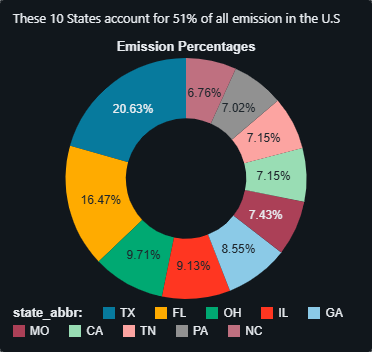
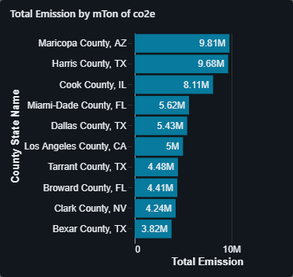
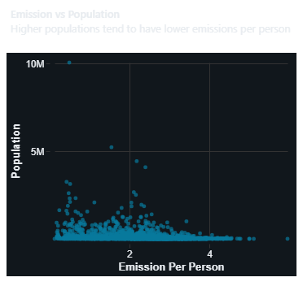

# U.S. Emissions Dashboard
## Dataset: [Emission_Data_203](/Emissions_Data_2023.csv)
An interactive AI/BI dashboard exploring county-level greenhouse gas (GHG) emissions across the United States for 2023. Built with Databricks AI/BI Dashboards on top of Unity Catalog data.

## Overview

The dashboard surfaces where emissions are concentrated, how they relate to population, and which states and counties contribute the most. It answers questions like:

- Where are emissions geographically concentrated?
- Do high-population areas emit more per person?
- Which states account for the largest share of national emissions?
- Which counties have the highest total emissions?

## Data Source

**Table:** `emissions.default.emissions_data` (Delta, Unity Catalog)

2023 U.S. county-level emissions and energy data, including:

| Column | Description |
| --- | --- |
| `county_state_name` | County and state (e.g., "Thayer County, NE") |
| `state_abbr`, `state_id` | State identifiers |
| `latitude`, `longitude` | County coordinates |
| `population` | County population |
| `GHG emissions mtons CO2e` | GHG emissions in metric tons CO2e (stored as text with thousands separators) |
| `consumption (MWh)`, `consumption (TcF)`, `consumption (gallons)` | Utility consumption metrics |
| `vehicle miles traveled (miles)` | Transportation usage |
| `employment`, `buildings`, `establishments` | Economic indicators |

> **Note:** Most consumption/emission columns are stored as strings with commas (e.g., `156,670`). Queries strip separators and cast to numeric before aggregating.

## Dashboard Widgets

| Widget | Type | Description |
| --- | --- | --- |
| United States Emissions Breakdown | Header | Dashboard title banner |
| U.S Continental Emission | Symbol map | County emissions plotted by latitude/longitude |
| Emission vs Population | Scatter plot | Emissions per person vs. population per county — higher-population counties tend to emit less per person |
| Emission Percentages | Pie chart | Top 10 states by total emissions (together ~51% of U.S. emissions) |
| Total Emission by mTon of co2e | Bar chart | Top 10 counties ("County Shaming") ranked by total emissions |

## Metrics

- **Total Emission** — `SUM(GHG emissions mtons CO2e)` per state or county
- **Emissions per Person** — total emissions ÷ county population
- **Emission Percentages** — share of national emissions among the top 10 states

## Getting Started

1. Ensure the `emissions` catalog and `emissions.default.emissions_data` table are accessible in your workspace.
2. Open the dashboard: `/sql/dashboardsv3/01f1e4ddc577126487b8aa54dcf7152f`
3. The companion query notebook (`New Query 2026-11-20 13:46:17.dbquery.ipynb`) computes per-county emissions, population, and emissions-per-person.

## Key Findings

- The top 10 states account for roughly **51%** of all U.S. emissions.

- Sparsely populated counties (e.g., Thayer County, NE at ~5.9 mtons/person) show the highest per-capita emissions

- while populous counties emit less per person.

## Tech Stack

- Databricks AI/BI Dashboards
- Databricks SQL (Serverless)
- Unity Catalog (Delta Lake)